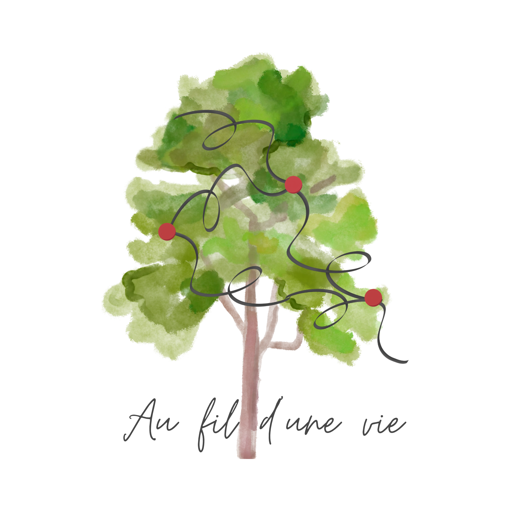
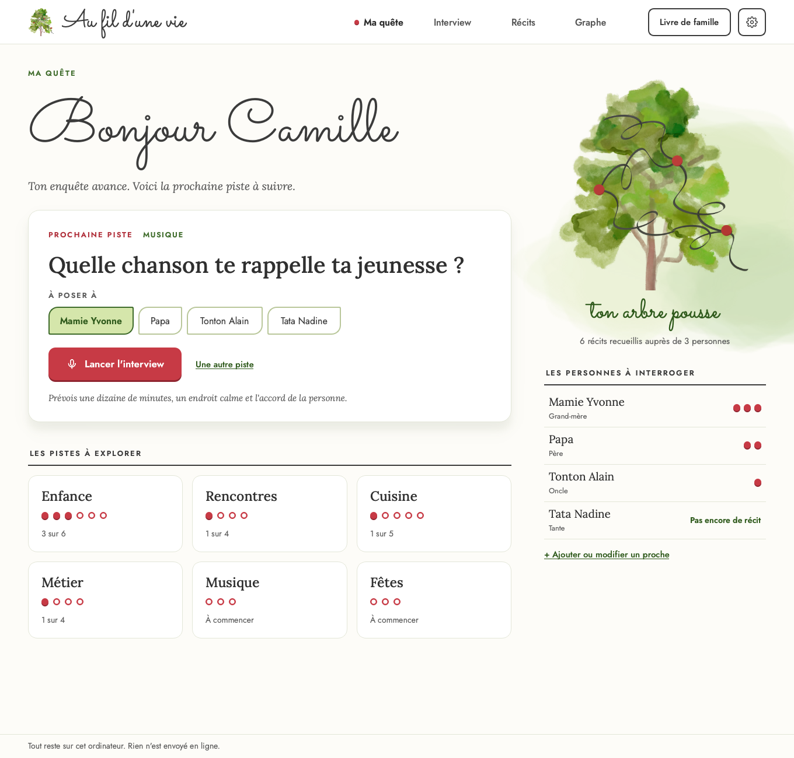
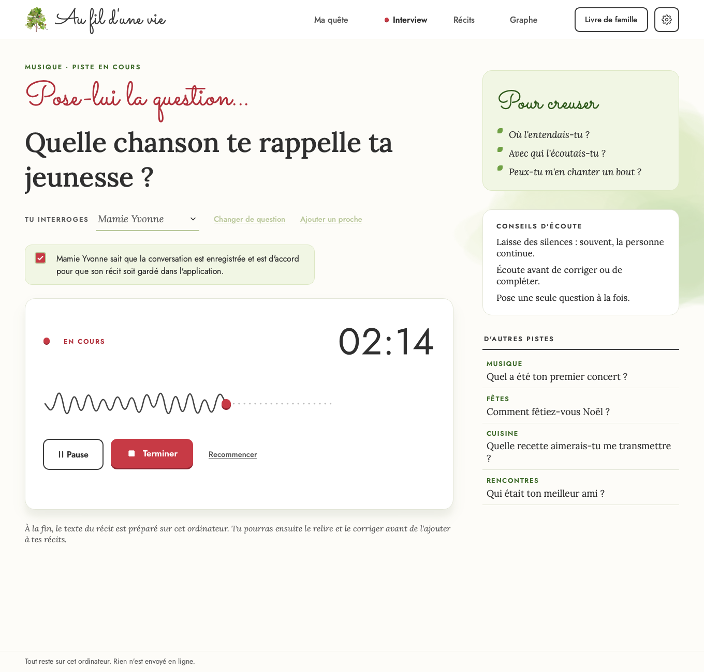
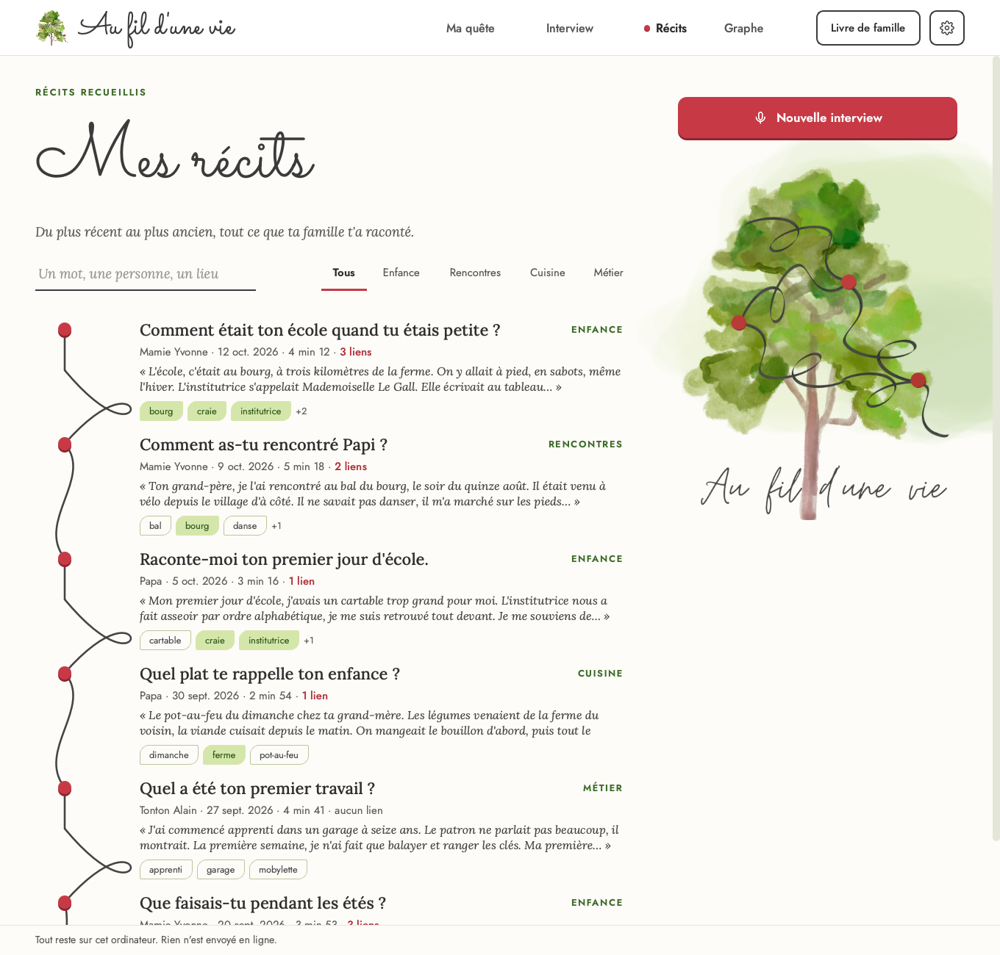
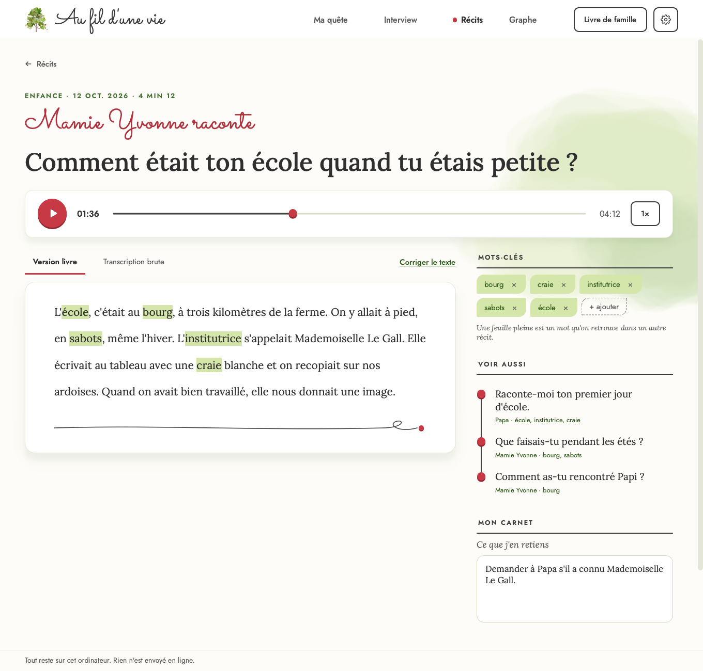
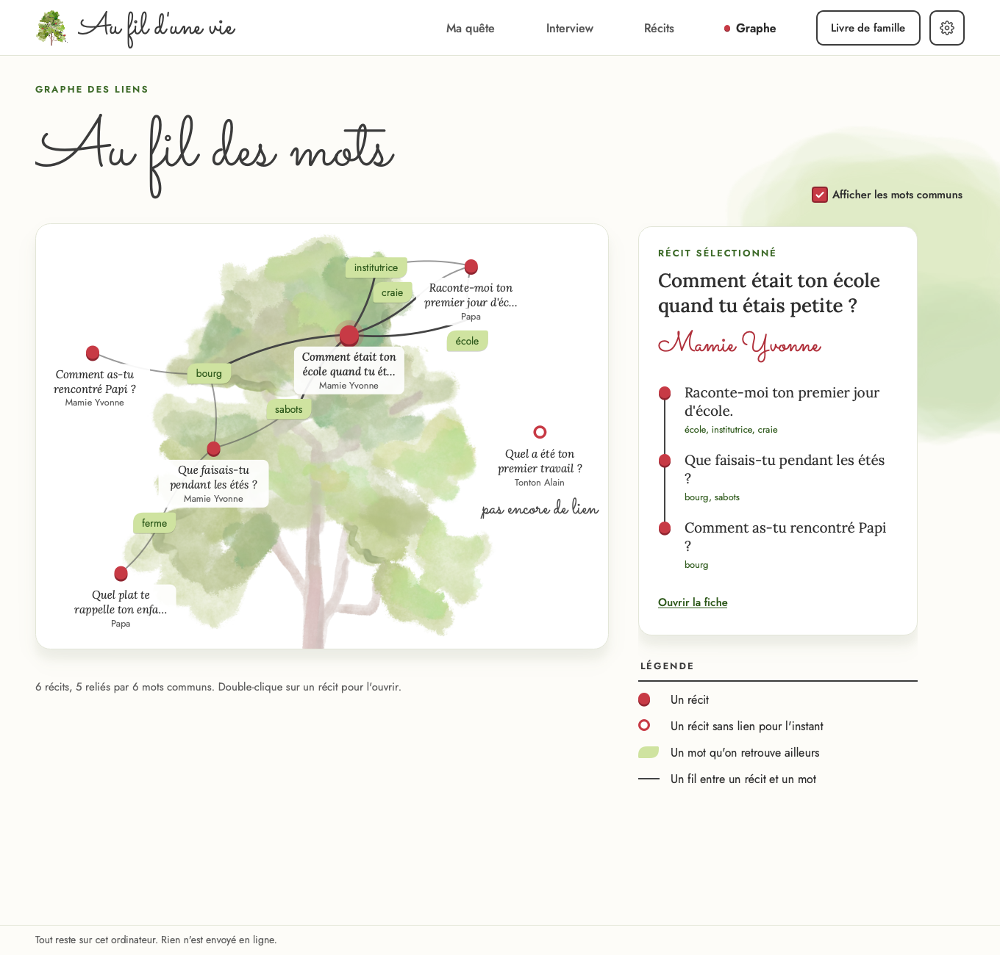
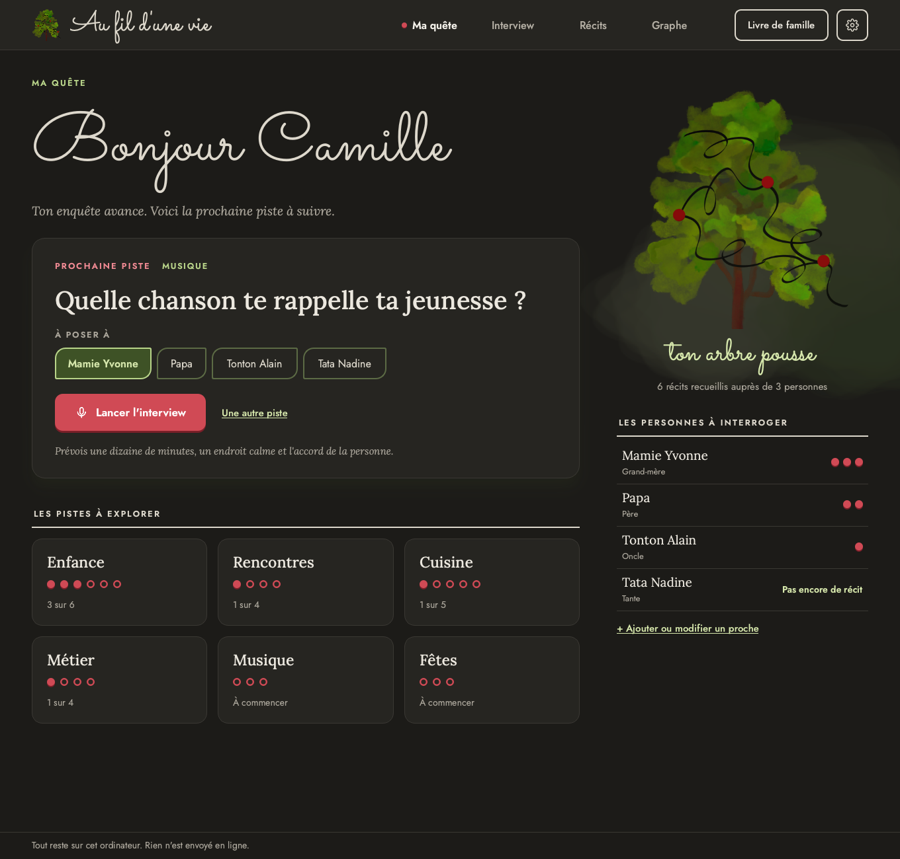
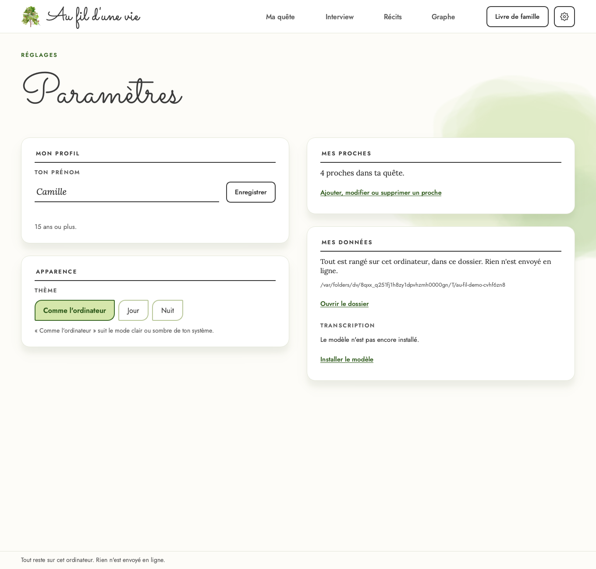

# Au fil d'une vie

[](https://github.com/emerylenaiglaborderie-creator/au-fil-d-une-vie/actions/workflows/ci.yml)

<p align="center"></p>

Application de bureau pour les 12 à 25 ans : partir en quête de son histoire familiale en interviewant ses proches. Chaque récit est enregistré, transcrit **sur l'ordinateur**, puis relié aux autres par ses mots-clés pour former un graphe de souvenirs.

> Tout reste sur cet ordinateur. Rien n'est envoyé en ligne.

Projet de BTS SIO option SLAM.

<p align="center">
  
  
  
  
  
  
  
</p>

## État

| Partie | Avancement |
|---|---|
| Base de données, repositories | fait |
| Mots-clés (TF-IDF) et liens entre récits | fait |
| Écrans « Ma quête » et « Interview » (enregistrement audio) | fait |
| Transcription locale (faster-whisper) et mots-clés proposés | fait |
| Récits (fil, recherche, filtres) et Fiche récit (écoute, correction, mots-clés, carnet, masquer, supprimer) | fait |
| Graphe des liens (récits et mots communs, networkx) | fait |
| Premier lancement (prénom, accord parental sous 15 ans) et gestion des proches | fait |
| Paramètres : prénom, thème Jour / Nuit / comme l'ordinateur ; icône de l'application | fait |
| Livre de famille en PDF (sommaire, Voir aussi, index des mots) : [exemple](docs/captures/livre-exemple.pdf) | fait |

## Stack technique

| Domaine | Choix | Rôle dans l'application |
|---|---|---|
| Langage | **Python 3.12** | Tout le code, de l'interface au calcul des liens |
| Interface | **PySide6** (Qt 6) : QtWidgets, QSS, QPainter | Écrans, composants maison dessinés (fil, points rouges, étiquettes feuilles) |
| Polices | Sacramento, Jost, Lora (licence OFL, embarquées) | Écriture manuscrite, interface, texte des récits |
| Audio | **QtMultimedia** (`QAudioSource`, `QMediaPlayer`) + module `wave` | Enregistrement WAV 16 kHz mono, lecture des récits |
| Transcription | **faster-whisper** (CTranslate2, processeur, int8), modèle `small` ou `base` | Texte des récits, calculé sur l'ordinateur |
| Analyse du français | **spaCy** `fr_core_news_md` | Lemmes, noms, entités (personnes, lieux) |
| Mots-clés | **TF-IDF** écrit en Python | Proposition des mots les plus caractéristiques, validés par l'utilisateur |
| Liens | Mots partagés pondérés par leur **rareté** (IDF) | Force du lien entre deux récits, « Voir aussi » |
| Graphe | **networkx** (`spring_layout`, composantes connexes) | Placement des récits et des mots communs |
| Livre de famille | **ReportLab** (`multiBuild`, `TableOfContents`, `SimpleIndex`) | PDF avec sommaire, renvois « Voir aussi » et index |
| Base de données | **SQLite** via `sqlite3`, SQL écrit à la main, mode WAL | Récits, consentements, textes, mots-clés, carnet |
| Dossiers de données | **platformdirs** | Emplacement propre à chaque système, jamais en dur |
| Tests | **pytest**, **pytest-qt** | Services, base, interface (sans écran) |
| Qualité | **ruff** (lint, format), **mypy** (strict) | Style et typage vérifiés |
| CI | **GitHub Actions** | Lint, typage et tests sur macOS, Windows et Ubuntu |
| Dépendances | **uv** (`pyproject.toml`, `uv.lock`) | Installation reproductible en une commande |

Architecture en trois couches (`ui/`, `services/`, `repositories/`) : l'interface ne parle qu'aux services, seuls les repositories touchent la base. Détails dans [`docs/`](docs/).

## Prérequis

- [uv](https://docs.astral.sh/uv/) (installe aussi la bonne version de Python)
- macOS, Windows ou Linux

## Installation et lancement

```bash
git clone https://github.com/emerylenaiglaborderie-creator/au-fil-d-une-vie.git
cd au-fil-d-une-vie
uv sync
uv run au-fil-d-une-vie          # ta propre quête
uv run au-fil-d-une-vie --demo   # avec le jeu de démo fictif
```

### Premier lancement

L'application propose de télécharger le modèle de transcription (environ 465 Mo, une seule fois). C'est la seule fois où elle utilise internet ; on peut refuser et enregistrer quand même, les textes seront préparés plus tard. Sur une machine modeste : `uv run au-fil-d-une-vie --modele base`. Détails : [docs/transcription.md](docs/transcription.md).

### Micro

L'enregistrement utilise le micro par défaut du système (WAV 16 kHz mono, gardé dans le dossier de données).

- **macOS** : au premier enregistrement, le système demande l'accès au micro pour l'application qui lance le programme (Terminal, iTerm, VS Code...). En cas de refus : Réglages Système, Confidentialité et sécurité, Micro.
- **Linux** : un serveur audio (PipeWire ou PulseAudio) doit être actif.

## Développement

```bash
uv run pytest          # tests
uv run ruff check .    # lint
uv run ruff format .   # formatage
uv run mypy            # typage
uv run python scripts/captures.py       # captures d'écran (docs/captures/)
uv run python scripts/generer_images.py # images de l'interface à partir du logo
```

## Architecture

Trois couches dans `src/au_fil_d_une_vie/` :

- `ui/` : vues et contrôleurs
- `services/` : logique métier (enregistrement, transcription, mots-clés, liens, export)
- `repositories/` : accès SQLite

Détails dans [`docs/`](docs/).
