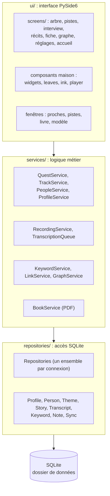
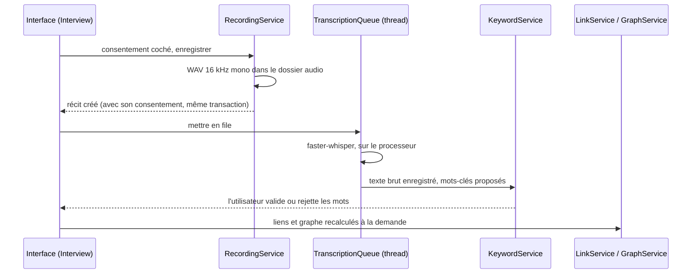

# Architecture

Client lourd en Python : l'interface, la logique et les données tournent sur l'ordinateur. Le code est rangé en trois couches dans `src/au_fil_d_une_vie/`, avec une règle simple : **chaque couche ne parle qu'à celle du dessous**.



| Couche | Rôle | Ce qu'elle ne fait jamais |
|---|---|---|
| `ui/` | Afficher, recevoir les actions, dessiner les composants maison (QSS + QPainter) | Toucher à la base, connaître SQL |
| `services/` | Règles métier : consentement, prochaine piste, mots-clés, liens, graphe, livre | Importer `sqlite3`, afficher quoi que ce soit |
| `repositories/` | SQL écrit à la main, requêtes paramétrées, transactions | Décider d'une règle métier |

La règle est vérifiable : `sqlite3` n'est importé que dans `repositories/`. Les services reçoivent des repositories, et l'assemblage passe par l'objet `Repositories` ([`repositories/bundle.py`](../src/au_fil_d_une_vie/repositories/bundle.py)), qui regroupe les repositories d'une même connexion.

## Assemblage

[`bootstrap.py`](../src/au_fil_d_une_vie/bootstrap.py) est le seul endroit où les trois couches se rencontrent : il ouvre la base (`Repositories.open`, migrations comprises), construit les services et remet à l'interface un unique objet `Services`. L'interface ne reçoit rien d'autre.

```
__main__.py  →  bootstrap.open_services()  →  Services  →  ui.app.run()  →  MainWindow
```

Le mode démo (`--demo`) ouvre une base temporaire remplie avec le jeu fictif (`data/demo.json`) : aucune vraie voix ni donnée réelle dans le dépôt.

## Parcours d'un récit



1. **Enregistrement** : `RecordingService` capture le micro (QtMultimedia) et écrit un WAV. Le récit et le consentement du proche sont insérés dans la même transaction : un récit ne peut pas exister sans consentement.
2. **Transcription** : `TranscriptionQueue` traite les récits un par un dans un thread à part (voir plus bas). Détails : [transcription.md](transcription.md).
3. **Mots-clés** : spaCy et TF-IDF proposent, l'utilisateur valide. Détails : [mots-cles-et-liens.md](mots-cles-et-liens.md).
4. **Liens** : calculés à la demande à partir des mots validés, pondérés par leur rareté.
5. **Graphe et livre** : `GraphService` place les récits sur le fil ([graphe.md](graphe.md)), `BookService` compose le PDF ([livre.md](livre.md)).

## Tâches longues et threads

L'écran ne se fige jamais :

| Tâche | Où elle tourne | Retour vers l'interface |
|---|---|---|
| Transcription et mots-clés | `TranscriptionQueue` : un thread de travail, sa file et sa propre connexion SQLite | `TranscriptionBridge` transforme ses rappels en signaux Qt |
| Téléchargement du modèle | `BackgroundTask` | signaux `succeeded` / `failed` |
| Livre PDF | `BackgroundTask` | signaux `succeeded` / `failed` |

Les deux relais sont dans [`ui/bridge.py`](../src/au_fil_d_une_vie/ui/bridge.py). Le travail tourne dans un thread Python (`threading`) ; les signaux Qt émis depuis ce thread sont livrés dans le thread de l'interface (connexion en file automatique), qui seul touche aux widgets. Ce choix plutôt que `QThread` garde `services/` indépendant de Qt : la file de transcription se teste sans interface.

Une connexion SQLite ne se partage pas entre threads : chaque thread ouvre la sienne (`Repositories.open`). La base est en mode WAL pour que l'interface lise pendant que la transcription écrit.

## Interface

- **Navigation par l'arbre** : l'accueil est un arbre dont les étiquettes ouvrent chaque section ; un mini arbre dans l'en-tête y ramène. Pas de menu.
- **Composants maison** dessinés en QPainter : étiquettes d'herbier, racines, fil, points rouges, rameaux, mètre ruban du graphe. Les tracés partagés (courbes de Bézier, traits effilés) sont dans [`ui/ink.py`](../src/au_fil_d_une_vie/ui/ink.py).
- **Thème** : deux palettes (Jour, Nuit) dans [`ui/theme.py`](../src/au_fil_d_une_vie/ui/theme.py), appliquées à la feuille de style et aux dessins ; changer de thème reconstruit la fenêtre.
- **Langues** : français et anglais, module `i18n` maison ; un test vérifie qu'aucune phrase n'est oubliée.

Détails et choix de direction artistique : [interface.md](interface.md).

## Préparation de la synchronisation

La base locale est prête à être synchronisée avec le serveur familial prévu (brief, section 7) :

- UUID sur les données échangées, journal des modifications tenu par des déclencheurs SQL (`sync_outbox`), versions connues du serveur (`sync_known`) ;
- `SyncRepository` lit et acquitte le journal, et applique les changements reçus sans les renvoyer.

Le serveur (API FastAPI, PostgreSQL) et le boîtier Raspberry Pi ne sont pas encore réalisés. Détails : [modele-donnees.md](modele-donnees.md) et [materiel.md](materiel.md).

## Qualité

| Outil | Rôle |
|---|---|
| pytest, pytest-qt | Tests des services, de la base et de l'interface (sans écran, `QT_QPA_PLATFORM=offscreen`) |
| ruff | Lint et formatage |
| mypy (strict) | Typage |
| GitHub Actions | Les trois vérifications sur macOS, Windows et Ubuntu |

Les tests d'interface couvrent aussi des cas limites rencontrés en développement : beaucoup de proches (mise en page qui débordait), grande famille fictive de 80 à 200 récits pour le graphe (paliers, défilement, temps de calcul).
