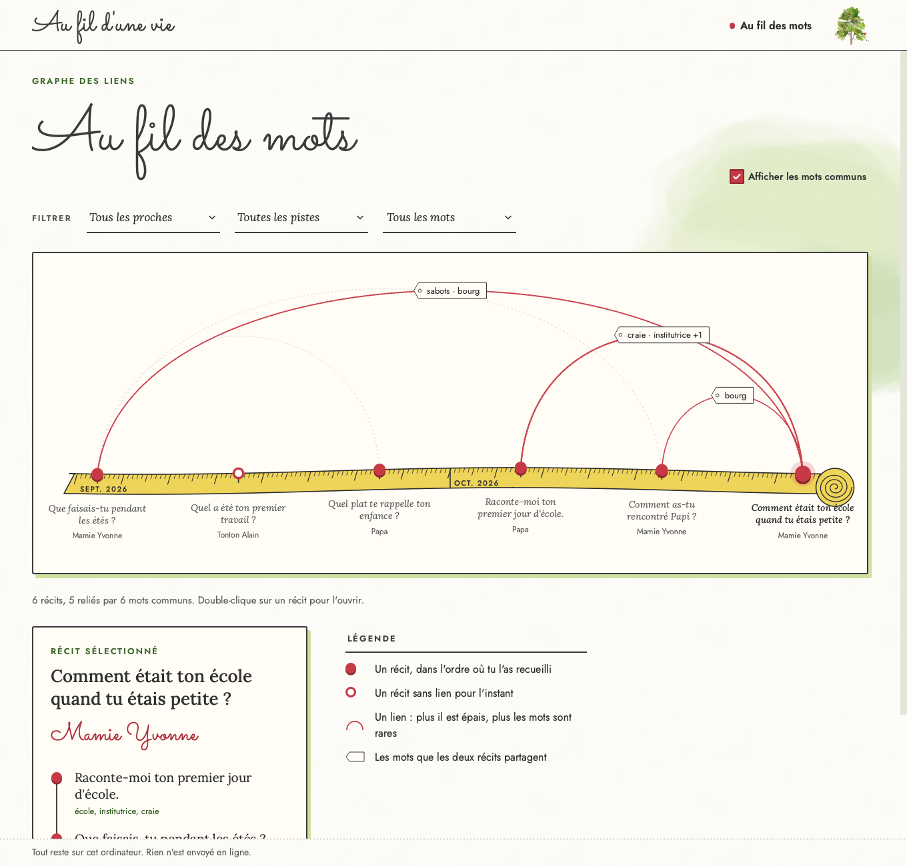

# Graphe des liens : « Au fil des mots »

## Principe

Les récits sont posés **sur un mètre ruban**, dans l'ordre où ils ont été recueillis. Deux récits qui partagent des mots validés sont **reliés par un arc** au-dessus du ruban, qui porte ces mots.

Le mètre ruban rappelle à la fois la couture (le fil de l'application) et la **toise du mur** où l'on marque la taille des enfants : chaque récit y est une marque, avec son point rouge, et les mois sont imprimés sur le ruban comme les chiffres d'un mètre.

| Élément | Signification |
|---|---|
| Point rouge plein sur le ruban | Un récit |
| Point vide | Un récit sans lien pour l'instant |
| Fil rouge | Un lien du récit choisi ; à peine plus épais si ses mots sont rares |
| Faufilage (pointillés clairs) | Les autres liens, en retrait |
| Étiquette de papier | Les mots partagés, du plus rare au plus courant |

**Focus** : les liens du récit sélectionné ou survolé deviennent un fil rouge, les autres s'effacent ; les mots ne s'affichent que sur ses cinq liens les plus forts. Double-clic sur un récit : sa fiche s'ouvre.

## Pourquoi un diagramme en arcs

La première version plaçait récits et mots librement (`spring_layout` de networkx). Le résultat changeait de forme avec les données, les étiquettes se chevauchaient et le schéma devenait illisible au-delà d'une dizaine de récits.

Le diagramme en arcs a été retenu parce que :

- il reprend l'identité de l'application (un fil, des points rouges) ;
- l'ordre a un sens, celui du temps de la quête ;
- aucun chevauchement n'est possible entre récits, quel que soit leur nombre ;
- il passe à l'échelle par paliers, sans jamais retirer un récit.

## Paliers d'affichage

Le nombre de récits change l'affichage, jamais le contenu :

| Récits affichés | Affichage |
|---|---|
| 1 à 15 | Tout est visible : titres et proches sous le ruban, tous les liens |
| Au-delà | **Compact** : titre sur une petite plaque au survol ; chaque récit ne montre que ses **3 liens les plus forts**, sauf le récit en focus qui montre tous les siens |
| Quand la largeur ne suffit plus | **Le ruban défile** horizontalement (barre ou molette), avec une **vue d'ensemble** au-dessus |

- Deux récits restent séparés d'au moins 26 px ; au-delà de ce que permet la largeur de la page, le plateau s'allonge.
- La **vue d'ensemble** montre tout le ruban en miniature et un cadre sur la partie affichée ; un clic ou un glissé déplace la vue. Elle n'apparaît que si le ruban défile.
- Les liens du récit choisi qui sortent de la vue sont tracés légèrement et résumés par une étiquette au bord (« ← 18 liens ») ; un clic ramène le récit lié le plus proche au centre.
- Les étiquettes de mots cherchent une place libre (au sommet de l'arc, au-dessus, au-dessous) sans sortir du plateau ; sans place, l'arc reste sans étiquette.

## Filtres

Trois filtres combinables sous le titre : **un proche**, **une piste**, **un mot** (on tape un morceau du mot). Cliquer sur l'étiquette d'un mot dans le graphe filtre aussi sur ce mot.

- Le ruban ne garde que les récits qui correspondent, répartis à nouveau sur toute sa longueur : une grande famille filtrée redevient lisible, titres compris.
- **Les liens sont calculés sur toute la famille**, puis restreints aux récits affichés : la force d'un lien et l'ordre des mots ne changent pas quand on filtre.
- Les choix proposés se limitent à ce qui a des récits visibles (et, pour les mots, aux mots partagés par au moins deux récits, les plus fréquents d'abord).
- « Tout afficher » retire les filtres ; le résumé indique « N récits sur M ».

## Répartition du code

| Fichier | Rôle |
|---|---|
| [`services/graph.py`](../src/au_fil_d_une_vie/services/graph.py) | Ordre et positions sur le ruban (entre 0 et 1), arcs et mots, liens forts, repères de mois, palier, filtres. Aucun code d'affichage |
| [`services/links.py`](../src/au_fil_d_une_vie/services/links.py) | Force des liens (mots partagés pondérés par leur rareté) : voir [mots-cles-et-liens.md](mots-cles-et-liens.md) |
| [`ui/screens/graph.py`](../src/au_fil_d_une_vie/ui/screens/graph.py) | Dessin (QPainter) : ruban, marques, fils, étiquettes ; focus, défilement, vue d'ensemble, filtres |

networkx ne sert plus qu'à compter les groupes de récits reliés entre eux (composantes connexes).

## Tests

- Service : ordre chronologique, arcs et mots, récit isolé, mois, stabilité du dessin, récits masqués, liens forts, filtres (proche, mot, combinaison, force inchangée).
- **Grande famille fictive** générée dans les tests (jamais dans le jeu de démo) : 80 récits pour le palier compact, 200 récits pour le temps de calcul (moins de 2 secondes).
- Interface : sélection au clic et au survol, palier compact à 30 récits, défilement et vue d'ensemble à 120 récits, étiquette « liens hors de vue », filtres et clic sur un mot.
