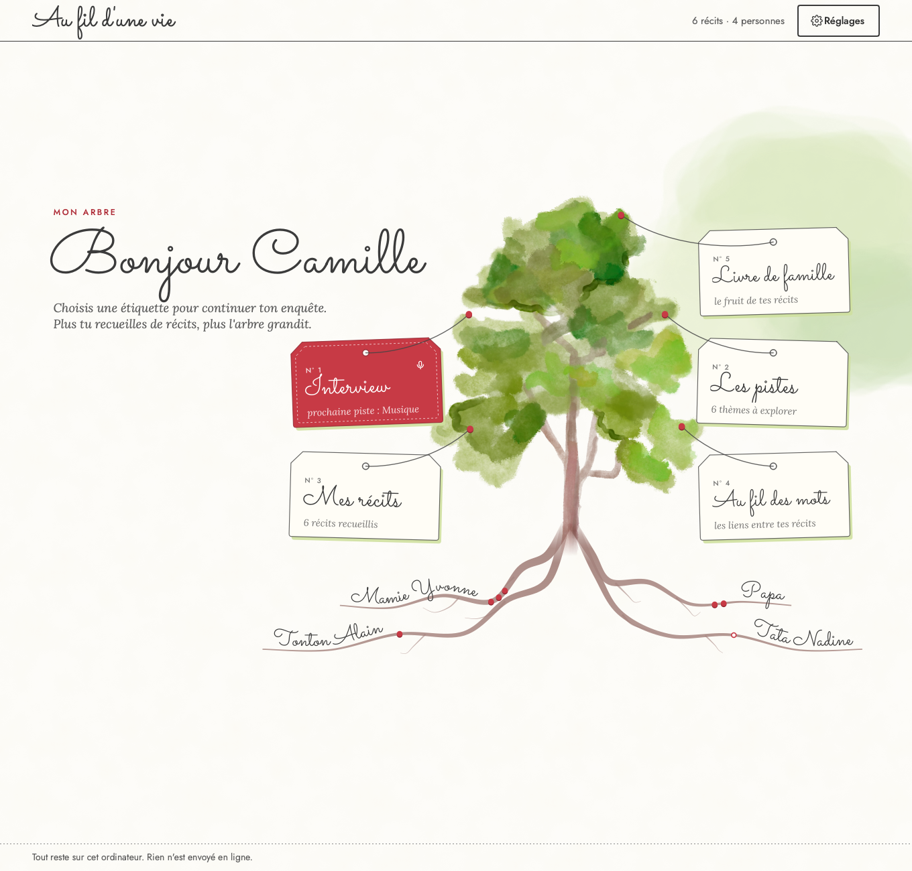
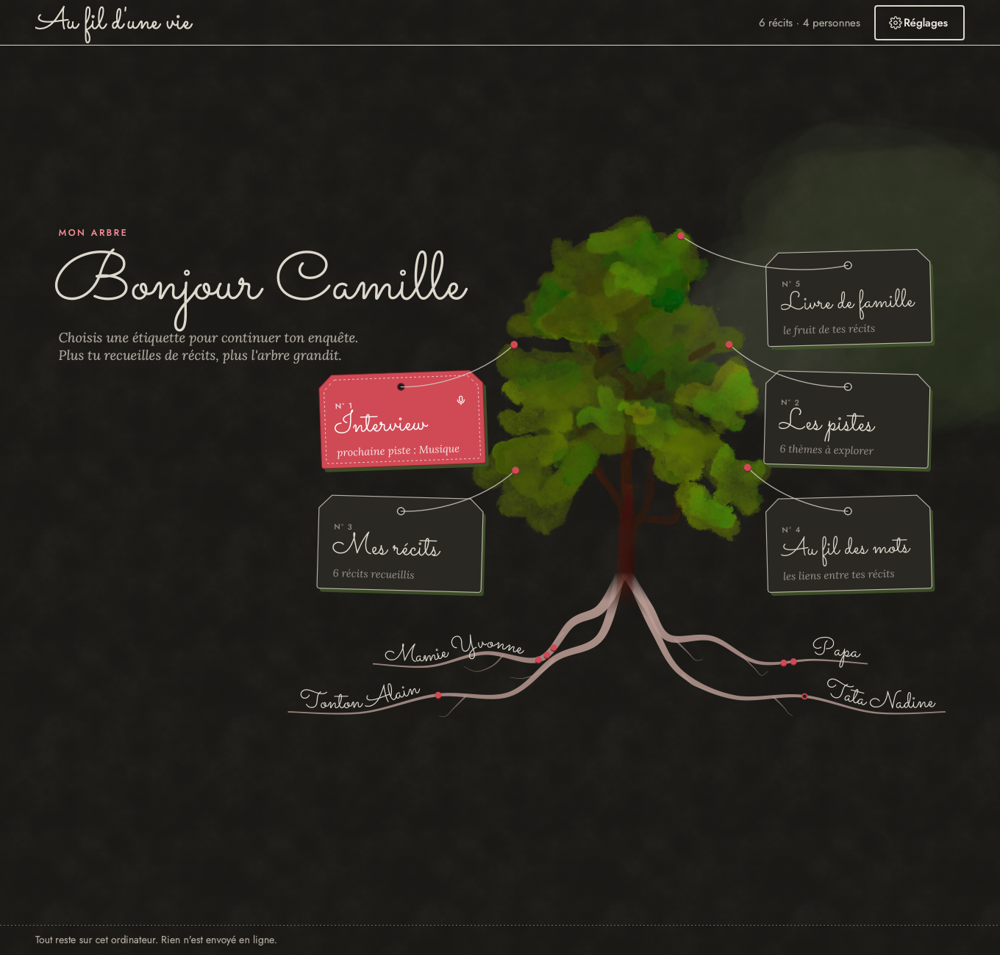

# Interface

Application PySide6 (Qt 6). Direction artistique : une **planche d'herbier**, chaleureuse et nostalgique, terre et crème, avec une écriture manuscrite en touches et un motif central, **le fil qui relie des points rouges**. Référence complète : [brief.md](brief.md), section 4.

  
  

## Navigation par l'arbre

Il n'y a pas de menu. L'accueil est un arbre ([`screens/tree.py`](../src/au_fil_d_une_vie/ui/screens/tree.py)) :

- **cinq étiquettes d'herbier** numérotées, pendues au feuillage par un fil noué sur un point rouge, ouvrent chaque section : Interview (étiquette rouge, action principale), Les pistes, Mes récits, Au fil des mots, Livre de famille ;
- elles sont rangées sur deux colonnes et trois rangées qui se répondent ; elles se balancent au survol et au focus clavier, et apparaissent en fondu à l'ouverture ;
- **les racines portent les proches** : leur nom est écrit le long de la racine, leurs récits y sont des perles rouges ; un clic ouvre leurs récits. Au-delà de six proches, un lien « et N autres » ouvre la liste complète.

Sur les autres écrans, l'en-tête montre la section courante (point rouge) et un **mini arbre cliquable** qui ramène à l'accueil. Sur l'arbre, l'en-tête résume la famille (« Famille Morvan · 6 récits · 4 personnes ») et donne accès aux réglages.

## Écrans

| Écran | Fichier | Contenu |
|---|---|---|
| Premier lancement | `screens/welcome.py` | Prénom, nom de famille (facultatif), âge (accord parental sous 15 ans), premiers proches, langue |
| Mon arbre | `screens/tree.py` | Accueil et navigation |
| Les pistes | `screens/quest.py` | Prochaine piste à poser, avancement des pistes, personnes à interroger |
| Interview | `screens/interview.py` | Question, consentement du proche, enregistreur (onde dessinée comme un fil), relances |
| Mes récits | `screens/stories.py` | Fil vertical des récits, recherche, onglets par piste |
| Fiche récit | `screens/story.py` | Écoute, version livre et transcription brute, correction, mots-clés, « Voir aussi », carnet, masquer, supprimer |
| Au fil des mots | `screens/graph.py` | Graphe des liens : voir [graphe.md](graphe.md) |
| Réglages | `screens/settings.py` | Profil, thème, langue, proches, pistes, données, modèle |

Fenêtres secondaires : proches, pistes et questions, livre de famille, téléchargement du modèle.

## Style herbier

| Élément | Rendu | Mise en œuvre |
|---|---|---|
| Papier | Crème avec un grain très fin | `grain.png` (bruit fractal raccordable, généré par `scripts/generer_images.py`) posé en mosaïque en lumière douce : le gris moyen ne change pas la couleur du fond |
| En-tête, pied de page | Trait d'encre sous l'en-tête, pointillés au-dessus du pied de page | `widgets.Paper` |
| Fiches | Fond papier, bord d'encre 1,5 px, coins quasi droits, **ombre pleine décalée** vert lavis | QSS + `widgets.wash_shadow` (`QGraphicsDropShadowEffect` sans flou) |
| Encarts (consentement, conseils) | Fond vert doux, bord pointillé | QSS |
| Listes | Séparateurs en pointillés | QSS |
| Boutons | Coins presque droits ; le bouton principal reste rouge avec son ombre pleine | QSS, `PrimaryButton` dessiné en QPainter |
| Rameaux | Brin d'encre, feuilles en lavis vert décalé, bourgeon rouge, dans les zones vides | `widgets.Sprig` |
| Étiquettes mots-clés | Forme « feuille » (deux coins arrondis, deux droits), remplies si le mot est partagé | `leaves.LeafChip` |

Les tracés à la main (racines effilées, rameaux) partagent leurs outils dans [`ui/ink.py`](../src/au_fil_d_une_vie/ui/ink.py) : splines lissées et traits qui s'affinent le long d'une courbe. Les dessins pseudo-aléatoires utilisent une **graine fixe** : l'arbre et les rameaux sont identiques à chaque lancement.

### L'arbre

L'arbre est l'aquarelle du logo (`arbre-accueil.png`, fond rendu transparent par le script d'images). Tout ce qui vit est dessiné par-dessus, dans une `QGraphicsScene` mise à l'échelle de la fenêtre : étiquettes, fils, racines, ombre du sol. Le bas du tronc se fond dans le sol et les racines partent de l'intérieur du tronc, dessinées sous l'image ; la position du tronc est mesurée dans l'image et vérifiée par un test.

Ce choix (image existante + dessin vectoriel) plutôt qu'un arbre entièrement généré garde l'identité du logo et isole le dessin dans un seul module : le remplacer ne toucherait à rien d'autre.

## Thèmes et langues

- **Jour / Nuit / comme l'ordinateur** : deux palettes de jetons de couleur dans [`theme.py`](../src/au_fil_d_une_vie/ui/theme.py). Changer de thème reconstruit la fenêtre avec l'autre palette.
- **Français / anglais** : chaque texte passe par `_()`, avec un catalogue anglais ; un test vérifie qu'aucune phrase n'est oubliée, et un autre parcourt l'interface en anglais à la recherche de français resté à l'écran.

## Accessibilité

- Étiquettes de l'arbre, racines et mini arbre utilisables au clavier (Tab, Entrée, Espace), avec un repère de focus rouge qui n'apparaît qu'au clavier.
- Noms accessibles sur les composants dessinés (`setAccessibleName`), infobulles sur les éléments graphiques.
- Polices embarquées (Sacramento, Jost, Lora, licence OFL) : rendu identique sur les trois systèmes.

## Robustesse de la mise en page

Deux problèmes rencontrés et corrigés, couverts par des tests :

- **Textes sur plusieurs lignes** : une zone de défilement Qt ne réserve qu'une ligne à un texte replié ; la page prenait la différence sur ses voisins (le bouton « Lancer l'interview » recouvrait les noms des proches). `WrappingLabel` et `FlowLayout` imposent désormais leur vraie hauteur comme minimum, recalculée à chaque changement de largeur.
- **Beaucoup de proches** : les choix de proches passent à la ligne, la liste « Mes proches » défile au-delà de cinq personnes, l'arbre affiche six racines et un lien vers les autres.

## Limites connues

- Le titre du dernier récit du graphe peut toucher le rouleau du mètre ruban.
- Le pied de page dit encore « Tout reste sur cet ordinateur » : il deviendra « Tout reste à la maison » avec la synchronisation (brief, section 7).
- Le livre PDF n'a pas encore le style herbier.
