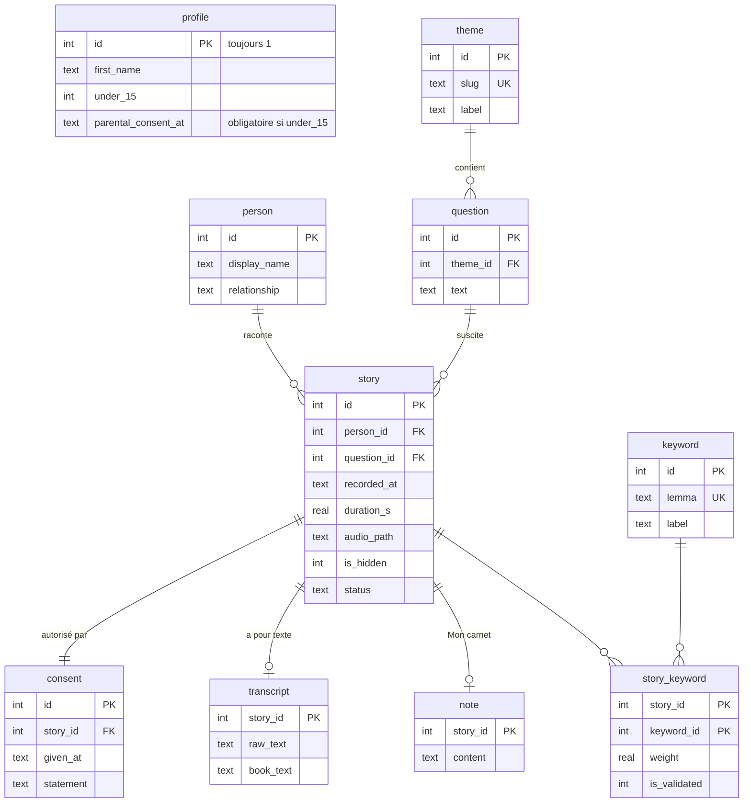

# Modèle de données

Base SQLite locale, accédée uniquement par la couche `repositories/` avec le module standard `sqlite3` (SQL écrit à la main, requêtes paramétrées). Schéma : [`0001_initial.sql`](../src/au_fil_d_une_vie/repositories/migrations/0001_initial.sql).

## Règles portées par la base

| Règle | Mécanisme |
|---|---|
| Sous 15 ans, l'accord d'un parent est requis | `CHECK (under_15 = 0 OR parental_consent_at IS NOT NULL)` |
| Pas de récit sans consentement du proche | Récit et consentement insérés dans la même transaction (`StoryRepository.create`) |
| Supprimer un récit efface tout ce qui s'y rattache | `ON DELETE CASCADE` sur consentement, texte, mots-clés, note |
| Supprimer un proche efface ses récits | `ON DELETE CASCADE` sur `story.person_id` |
| Une question déjà utilisée ne peut pas disparaître | `ON DELETE RESTRICT` sur `story.question_id` |
| Pas de mot-clé orphelin | Déclencheur `trg_keyword_orphan` |
| La correction de l'utilisateur n'est jamais écrasée | `save_raw` ne touche pas à `book_text` |
| Seuls les mots validés créent des liens | `KeywordRepository.validated_pairs` (récits masqués exclus) |

## Choix

- **Dates** en texte ISO 8601 UTC, lisibles et triables.
- **Chemins audio** relatifs au dossier audio, pour que la base reste valable si le dossier de données change.
- **Migrations** numérotées (`0001_...sql`), version suivie par `PRAGMA user_version`, chaque migration dans sa propre transaction.
- **Une connexion par thread** : la transcription, hors du thread d'interface, ouvre sa propre connexion.
