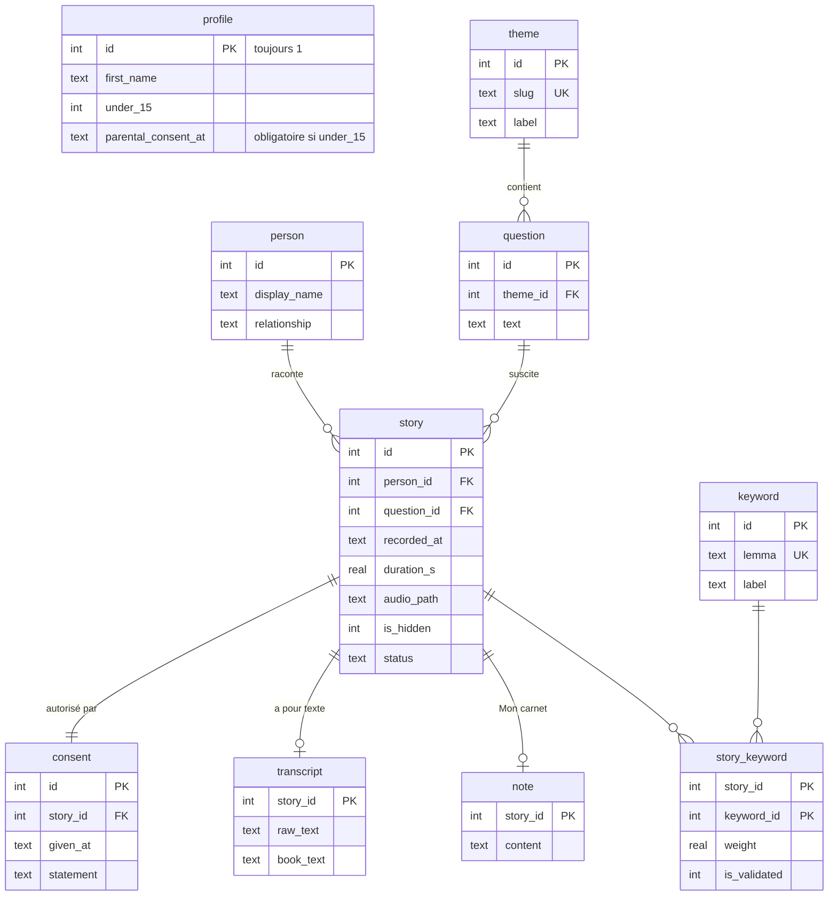

# Modèle de données

Base SQLite locale, accédée uniquement par la couche `repositories/` avec le module standard `sqlite3` (SQL écrit à la main, requêtes paramétrées). Schéma : [`0001_initial.sql`](../src/au_fil_d_une_vie/repositories/migrations/0001_initial.sql), complété par les migrations suivantes dont [`0004_sync.sql`](../src/au_fil_d_une_vie/repositories/migrations/0004_sync.sql) (préparation de la synchronisation, voir plus bas). Le diagramme ne montre pas la colonne `uuid` ajoutée par cette migration.

## Règles portées par la base

| Règle | Mécanisme |
|---|---|
| Sous 15 ans, l'accord d'un parent est requis | `CHECK (under_15 = 0 OR parental_consent_at IS NOT NULL)` |
| Pas de récit sans consentement du proche | Récit et consentement insérés dans la même transaction (`StoryRepository.create`) |
| Supprimer un récit efface tout ce qui s'y rattache | `ON DELETE CASCADE` sur consentement, texte, mots-clés, note |
| Supprimer un proche efface ses récits | `ON DELETE CASCADE` sur `story.person_id` |
| Une question déjà utilisée ne peut pas disparaître | `ON DELETE RESTRICT` sur `story.question_id` |
| Pas de mot-clé orphelin | Déclencheur `trg_keyword_orphan` |
| La correction de l'utilisateur n'est jamais écrasée | `save_raw` ne touche pas à `book_text` |
| Seuls les mots validés créent des liens | `KeywordRepository.validated_pairs` (récits masqués exclus) |
| Toute donnée synchronisée a un UUID fixe | Déclencheurs `trg_*_uuid_required` et `trg_*_uuid_fixed`, index uniques |
| Toute modification locale est journalisée pour l'envoi | Déclencheurs `trg_*_sync_*` vers `sync_outbox` |

## Choix

- **Dates** en texte ISO 8601 UTC, lisibles et triables.
- **Chemins audio** relatifs au dossier audio, pour que la base reste valable si le dossier de données change.
- **Migrations** numérotées (`0001_...sql`), version suivie par `PRAGMA user_version`, chaque migration dans sa propre transaction.
- **Une connexion par thread** : la transcription, hors du thread d'interface, ouvre sa propre connexion.
- **Repositories regroupés** : services et assemblage manipulent l'objet `Repositories` (un ensemble par connexion), jamais une connexion SQLite.

## Préparation de la synchronisation (migration 0004)

Chaque poste garde sa base SQLite et fonctionne hors connexion. Les échanges avec le serveur familial (brief, section 7.3) s'appuient sur les éléments suivants.

### Identifiants

- Les identifiants entiers (`id`) restent **locaux** : l'interface et les services les utilisent sans changement.
- `person`, `theme`, `question`, `follow_up` et `story` reçoivent un **UUID version 4**, attribué à la création par les repositories, obligatoire et non modifiable. C'est lui qui désigne la donnée auprès du serveur.
- Le texte, la note et les mots-clés validés d'un récit sont désignés par l'**UUID du récit**. Les mots-clés eux-mêmes sont reconnus par leur lemme.

### Tables

| Table | Rôle |
|---|---|
| `sync_outbox` | Journal des modifications locales à envoyer : une ligne par donnée, opération `upsert` ou `delete`, numéro `revision` jamais réutilisé |
| `sync_known` | Données que le serveur connaît, avec la version qu'il leur a donnée (base du verrouillage optimiste) |
| `sync_state` | Une ligne : dernier numéro de modification reçu du serveur, interrupteur du journal pendant l'application des changements reçus |

### Fonctionnement du journal

- Des **déclencheurs** remplissent `sync_outbox` à chaque ajout, modification ou suppression : les repositories n'ont rien à faire de plus, et aucune écriture ne peut être oubliée.
- Une donnée modifiée plusieurs fois n'a qu'une entrée, la plus récente.
- Une donnée **jamais envoyée puis supprimée** disparaît du journal sans laisser de trace.
- Une donnée **déjà connue du serveur puis supprimée** laisse une entrée `delete` qui ne contient que son UUID (droit à l'effacement : aucun contenu n'est conservé). La suppression d'un récit couvre son texte, sa note et ses mots-clés.
- L'acquittement d'un envoi vise le numéro `revision` lu : si la donnée a changé pendant l'envoi, sa nouvelle entrée reste à envoyer.
- Pendant l'application des changements reçus du serveur (`SyncRepository.applying_remote`), le journal se tait : rien n'est renvoyé au serveur. Tout est annulé en cas d'erreur.

### Données qui restent locales

| Donnée | Raison |
|---|---|
| Profil | Propre au poste et à la personne qui l'utilise |
| Statut de transcription | Traitement local à chaque poste |
| Mots-clés proposés non validés, poids, liens | Recalculés sur chaque poste à partir des mots-clés validés |
| Consentement | Immuable et créé avec le récit : il voyage avec lui |

### Piège SQLite évité

Dans un déclencheur, `INSERT OR REPLACE` hérite de la règle de conflit de l'instruction qui l'a déclenché. Avec un `ON CONFLICT DO UPDATE` (utilisé par exemple pour enregistrer un texte), le remplacement échouait. Les déclencheurs font donc une suppression puis une insertion explicites.
